# dsh-carlotta-theme · 珂莱塔主题

给 [DeepSeek Harness（DSH）](https://github.com/deepseek-ai) 桌面版用的《鸣潮》珂莱塔主题插件。非官方、非商业的同人作品，与库洛游戏、DeepSeek 无关。

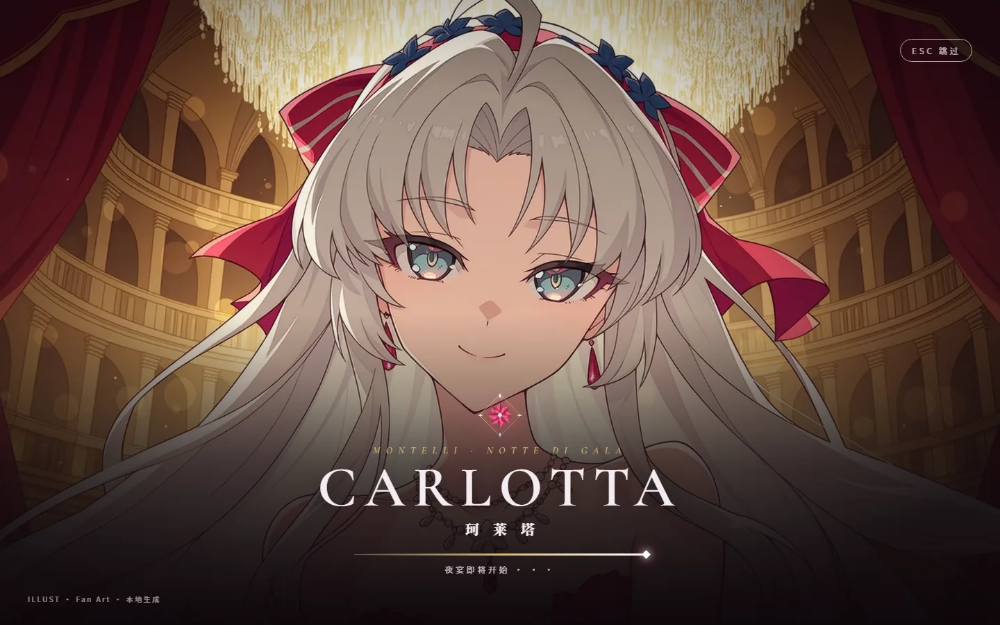

## 五套皮肤

| 皮肤 | 启动画面 | 主界面 |
| --- | --- | --- |
| **晶棱玫瑰 · 夜宴**（暗）<br>冰晶飘落 + 火花 |  | 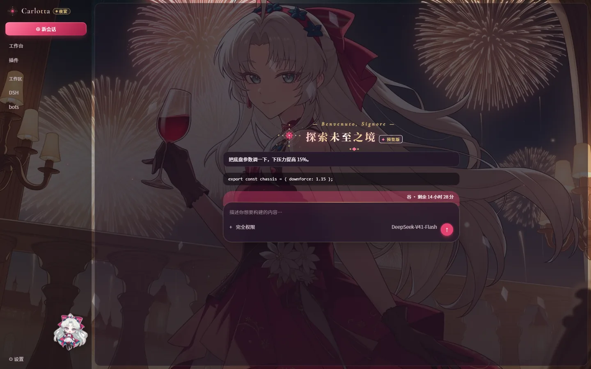 |
| **晶棱玫瑰 · 白昼**（亮）<br>冰晶飘落 + 火花 | 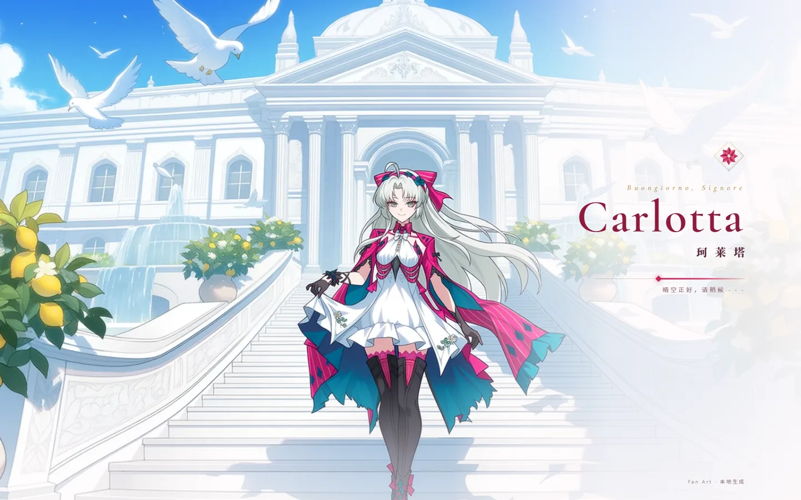 | 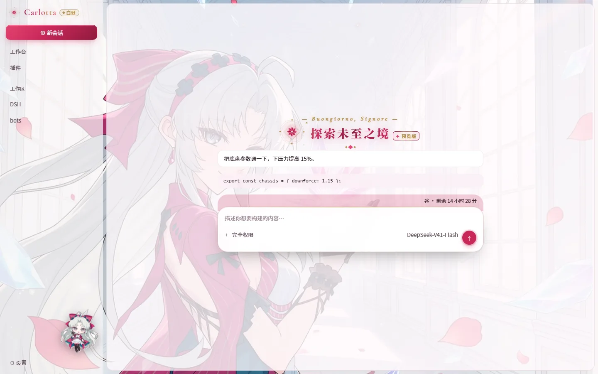 |
| **璀璨**（暗）<br>冰晶 + 彩虹光带 | 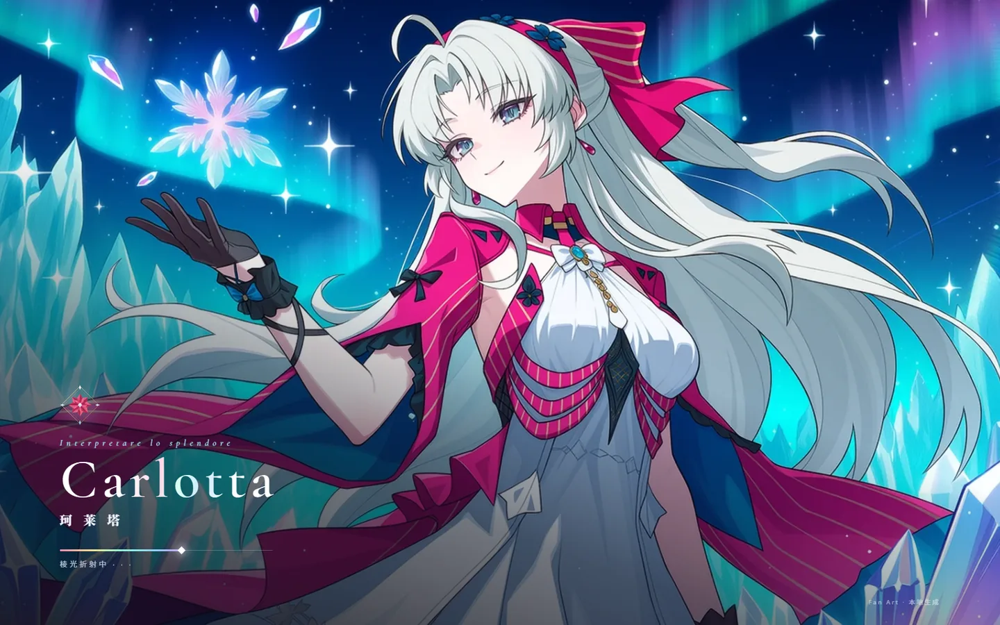 | 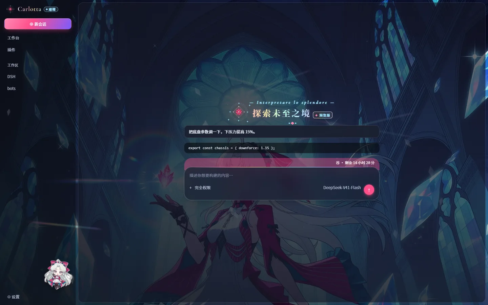 |
| **休憩日**（亮）<br>四叶草飘落 | 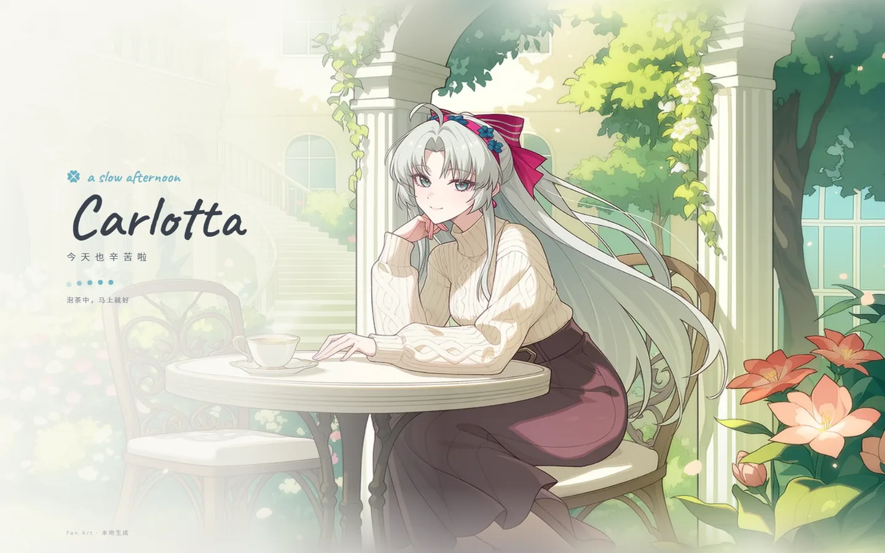 | 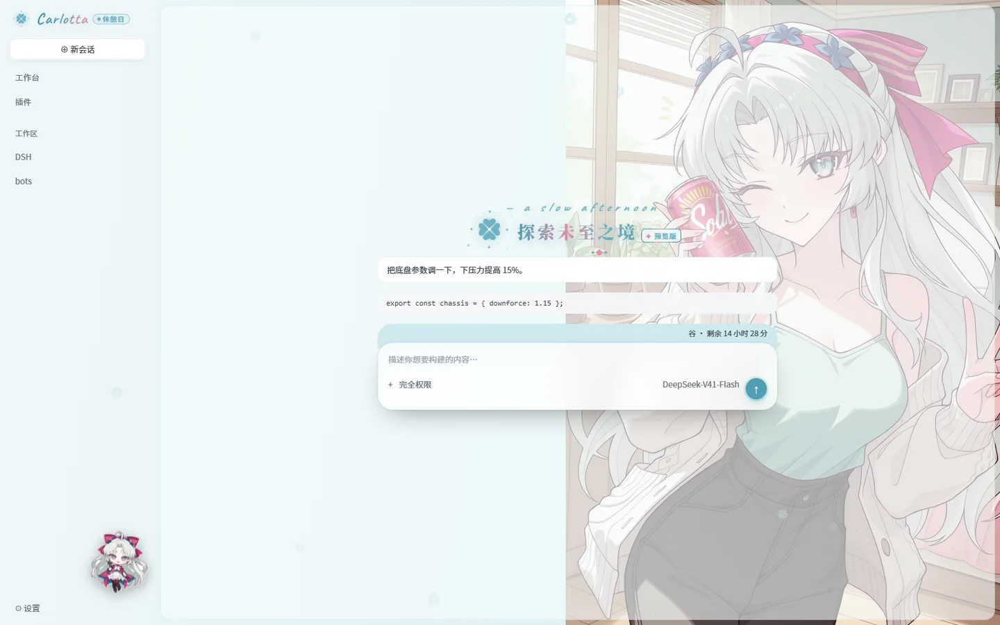 |
| **盛夏**（亮）<br>光斑 + 气泡 | 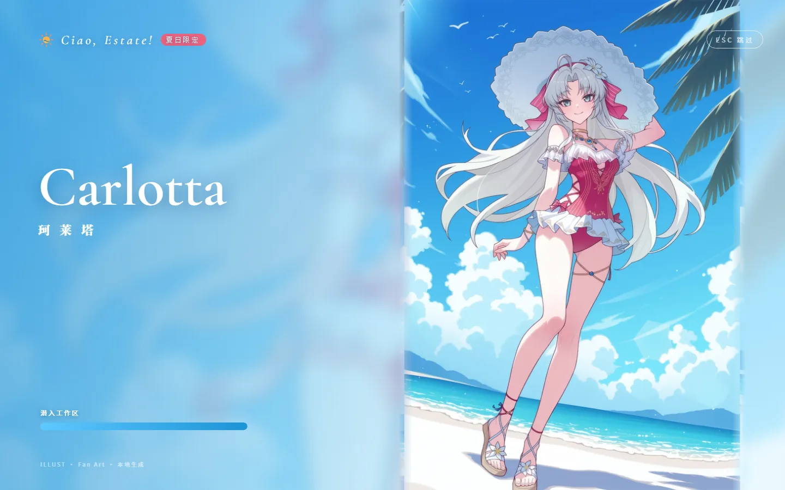 | 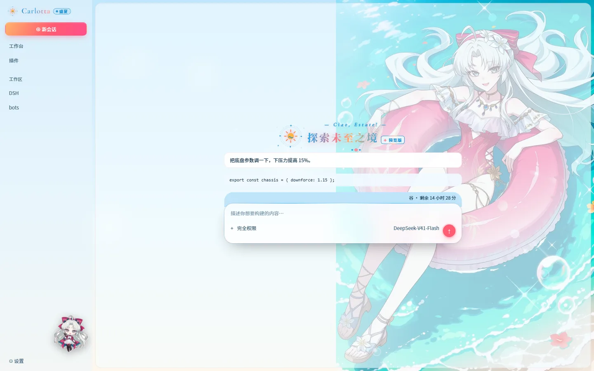 |

> 主界面截图来自插件自带的模拟测试页（`test/harness.html`），用来展示配色和装饰；装进 DSH 后，工作台、设置、插件、轨迹等所有窗口都会一起换色。

### 设置页

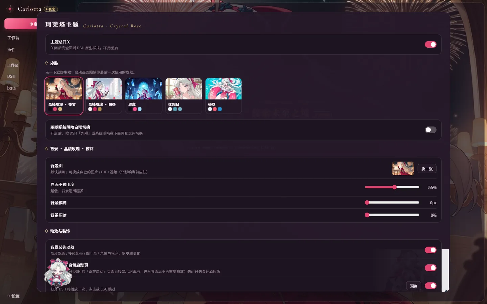

## 功能
- **全窗口换色**：DSH 所有窗口（主界面、工作台、设置、插件、轨迹、右侧栏、菜单、弹窗、提示）的颜色都来自约 100 个 `--dsw-alias-*` 变量，插件用官方 `ctx.theme.overrideTokens` 整套替换。弹窗、菜单、设置窗口始终不透明，文字不会叠在背景上。
- **背景图 + 动效**：每套皮肤一张壁纸，可在设置里换成自己的图片 / GIF / 视频；界面不透明度可调到 0，另有背景模糊、压暗。
- **启动画面**：每套皮肤一张专门的启动图，打开 DSH 时播放最后一次使用的那套。
- **替换 DSH 自带启动页**（设置里可关）：DSH 的「正在启动」页面在插件加载之前就显示，插件会改安装目录里的 `resources/splash.html`。
  第一次替换前备份成 `splash.html.carlotta-orig`，关闭开关即还原；DSH 更新覆盖后插件会自动重新替换。插件升级后的第一次启动仍显示旧画面，下一次起生效。
- **标题与侧栏**：首页标题带旋转光环徽章、流光渐变字、意大利语花体小字和菱形金线；侧栏换成皮肤徽章、流光 Carlotta 字样和皮肤名标签。
- **Q 版珂莱塔**：悬浮在侧栏右下角，可拖动、双击复位；点她弹出 DeepSeek **剩余额度**和**今日已用**。
- **设置页**集成在 DSH 设置左栏「珂莱塔主题」。
- 兼容 [dsh-peak-valley](https://github.com/dmscode/dsh-peak-valley)：峰谷条自动跟随皮肤配色。

## 安装
```bash
git clone https://github.com/xunnian0721-code/dsh-carlotta-theme.git
```
DSH 设置 → 插件 → 添加插件，填克隆下来的目录（绝对路径），装好后重启 DSH 桌面端。

注意：DSH 安装本地插件时会**复制一份快照**，之后改了文件要在插件页移除再重新添加才会生效。卸载：在插件页移除，界面立刻恢复原样。

## 余额与今日已用怎么算
- **剩余额度**：优先用 DSH 凭据里的 `DEEPSEEK_API_KEY` 查官方接口 `api.deepseek.com/user/balance`；没有 Key 时退回 DSH 登录的 DeepSeek 账号。
- **今日已用**：DeepSeek 没有「今日用量」接口，插件按北京时间每天记账——同一天里余额每少一次就累加，充值不算用量，每 15 分钟自动记一次。第一次运行的那天只能从开始记账的时刻算起（卡片会提示），之后每天零点接上前一天的余额。
- API Key 只在内存里用来发请求，不写日志、不写文件、不传给页面。

## 数据存放
DSH 桌面版每次启动端口会变，浏览器存储会丢，所以设置、自定义背景、记账本、启动页内容都存在本机文件：
`%APPDATA%\dsh-carlotta-theme\`（非 Windows：`~/.dsh-carlotta-theme/`）。

## 开发与测试
```bash
node test/host.test.mjs
```
宿主测试（20 项）：素材、设置读写、背景上传、拒绝外部请求、余额与今日已用记账、启动页替换与还原。

```bash
node test/serve.mjs
```
打开 http://127.0.0.1:47811/ ：用 DSH 颜色变量搭的模拟界面加载插件，余额是假数据。地址后加 `?clean` 隐藏测试按钮，加 `?settings` 打开设置窗口。

## 插画说明
仓库里的壁纸、启动图、Q 版和立绘，都是作者用本地模型（Anima base v1.0 + LoRA）生成的**非商业同人图**，不是游戏官方素材，也不是其他画师的作品。详见 [assets/ART.md](assets/ART.md)。

本作品遵循库洛游戏发布的《鸣潮》同人创作指引（1.1 版）：仅限个人非商业用途，不涉及任何金钱或虚拟货币收益。珂莱塔及《鸣潮》相关角色形象的知识产权归库洛游戏所有；同人作品不代表官方立场。如有不妥，请提 Issue，作者会及时处理。

## 致谢与许可
- 代码：MIT（见 [LICENSE](LICENSE)）。插画不适用 MIT，见上一节。
- 字体：[Cormorant Garamond](https://fonts.google.com/specimen/Cormorant+Garamond)、[Caveat](https://fonts.google.com/specimen/Caveat)，SIL Open Font License 1.1。
- 测试页用到的 React UMD：MIT。
- 写法参考了社区插件 dsh-peak-valley、DeepSeek-Balance-Whale-Widget、dsh-plugin-eva-theme、deepseek-harness-shorekeeper-theme、dsh-theme-endfield。
